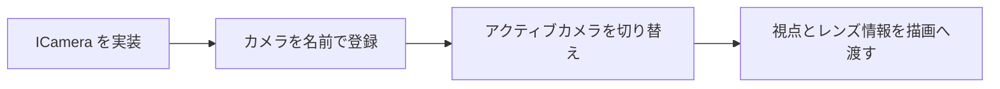

import TopicSummary from "../../../components/TopicSummary.astro";
import PageEnd from "../../../components/PageEnd.astro";

<TopicSummary />

## 概要

作品の観察とカメラ表現を両立するため、複数のカメラ実装を同じインターフェースで扱います。

## 処理フロー図



## 設計判断・処理の流れ

カメラごとの操作を共通インターフェースの裏へ分け、名前による登録と切り替えを管理クラスに集約します。

## 実装のポイント

CameraManagerは名前とICameraの対応を保持し、最初の登録カメラをアクティブにします。切替先が存在しない場合は失敗を返し、アクティブカメラがない場合はNullCameraを返します。焦点距離、F値、合焦距離などはDoFと撮影表現で共通に使います。

### 現行コードの抜粋

```cpp
  bool switch_camera(const std::string& name) {
    auto it = _cameras.find(name);
    if (it != _cameras.end()) {
      _active_camera = it->second;
      return true;
    }
    return false;
  }

```

## 制約・検証

視点操作とレンズ表現は別の責務です。カメラ切替時の時間方向履歴や、単位系と画面サイズに応じたCoCの変化も確認対象です。

## ソースコード

[camera_manager.h — 実装を読む](https://github.com/rumo-dev/AtmosFiore/blob/master/Project/source/Game/World/camera/camera_manager.h)

公開版と開発中のローカル版では、更新時点が異なる場合があります。

<PageEnd />
