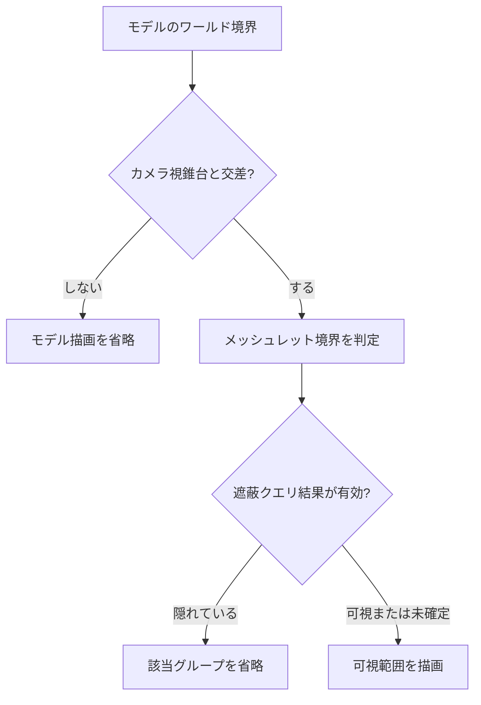

import TopicSummary from "../../../components/TopicSummary.astro";
import FeatureMedia from "../../../components/FeatureMedia.astro";
import PageEnd from "../../../components/PageEnd.astro";

<TopicSummary />

## 概要

カメラに映らないモデルや、遮蔽物の後ろに隠れた静的メッシュの描画を減らすため、モデル単位の視錐台判定に加えてメッシュレット単位の判定とオクルージョンクエリを実装しています。

## 遮蔽カリング比較

<FeatureMedia title="静止時のオクルージョンカリング" beforeImage="/media/atmosfiore/captures/screenshots/occlusion_off.png" afterImage="/media/atmosfiore/captures/screenshots/occlusion_on.png" beforeLabel="Occlusion OFF" afterLabel="Occlusion ON" caption="同じ視点でオクルージョンカリングを切り替えたデバッグキャプチャです。" />

<FeatureMedia title="メッシュレットカリング" beforeImage="/media/atmosfiore/captures/screenshots/meshlets_off.png" afterImage="/media/atmosfiore/captures/screenshots/meshlets_on.png" beforeLabel="Meshlet Culling OFF" afterLabel="Meshlet Culling ON" caption="視錐台に対するメッシュレット単位の描画範囲を比較しています。" />

## 判定の段階

## 実装のポイント

モデル単位ではワールド変換後のAABBをカメラの6平面と照合します。点光源シャドウパスでは各面の視錐台を使います。glTFプリミティブのインデックスはロード時に最大64頂点・126三角形のメッシュレットへ分割し、それぞれの境界を保存します。画面に一部だけ入るプリミティブでは境界を細分化して判定し、隣接する可視インデックス範囲をまとめて描画します。

点光源とスポットライトのアップロード時にも、ライトの範囲球をカメラ視錐台と照合して画面外の光源をGPU配列から除外します。スポットライトの円錐全体を厳密にテストする代わりに、位置と半径による球で保守的に判定します。

メッシュレットが8個以上あるプリミティブは、8メッシュレット単位のグループ境界を遮蔽判定に使います。オクルージョンクエリは静止中のカメラで少なくとも2フレーム待ってから発行し、4フレームごとに最大128クエリの予算で順番に更新します。結果は後続フレームで読み、未確定のグループは可視として扱います。カメラやモデルの変換が変わった場合も、古い結果で消えないよう再判定まで保守的に描画します。

## 適用範囲と確認方法

遮蔽カリングはDeferred Geometryの静的モデルが対象です。アニメーション中、スキン付き、カリング除外指定のモデルやカメラ視錐台を固定した比較中は利用しません。Directional ShadowはLiSPSMの投影で通常の視錐台が使えないため、モデル・メッシュレットの視錐台カリングを適用しません。

Model ManagerのデバッグUIからMeshlet CullingとOcclusion Cullingを個別に切り替え、テスト数、除外数、スキップ三角形数、クエリ発行数を確認できます。比較時はカメラを静止させ、オクルージョン結果が更新されたあとにON/OFFを見比べます。

## 制約

遮蔽クエリは前フレームの結果を使うため、カメラ移動直後には一時的に可視扱いになります。カリングは描画対象を減らす機能であり、すべてのパスで同じ判定を共有するものではありません。ここではGPU性能の改善率を断定せず、判定数と省略できたジオメトリをデバッグ情報で確認します。

## ソースコード

- [model_manager.cpp — パスごとの判定とクエリ管理](https://github.com/rumo-dev/AtmosFiore/blob/master/Project/source/Engine/System/Manager/Model/model_manager.cpp)
- [gltf_model.cpp — メッシュレット生成・描画判定](https://github.com/rumo-dev/AtmosFiore/blob/master/Project/source/Engine/Graphics/Model/gltf_model.cpp)
- [point_light_manager.cpp — 点光源の視錐台判定](https://github.com/rumo-dev/AtmosFiore/blob/master/Project/source/Engine/System/Manager/Light/point_light_manager.cpp)
- [spot_light_manager.cpp — スポットライトの視錐台判定](https://github.com/rumo-dev/AtmosFiore/blob/master/Project/source/Engine/System/Manager/Light/spot_light_manager.cpp)
- [scene_indoor.cpp — 描画後のクエリ発行](https://github.com/rumo-dev/AtmosFiore/blob/master/Project/source/Game/Scenes/scene_indoor.cpp)

<PageEnd />
