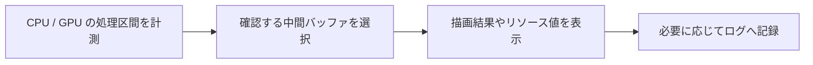

import TopicSummary from "../../../components/TopicSummary.astro";
import PageEnd from "../../../components/PageEnd.astro";

<TopicSummary />

## 概要

最終画像だけでは原因を特定しにくいため、中間結果と処理時間を観察する仕組みを実装しました。最近は、作品を説明しながら操作できるプレゼンテーションモードも追加しています。

## 処理フロー図



## 設計判断・処理の流れ

最終画像だけでなく中間結果と処理区間を観察できるよう、GUIのプレビューと計測用の区間を組み合わせます。

```text
シーン描画 → TracyのCPU/GPU区間 → 中間バッファ表示 → パラメータ調整
```

## 実装のポイント

Post_Process_ManagerのGUIからG-Buffer、平行光と点光源の深度、Bloomの中間結果を選択できます。Resource_MonitorはCPU、メモリ、プロセス情報、FPSとフレーム時間を保持し、履歴表示とログ出力を備えています。

プレゼンテーションモードでは、Scene・Rendering・Cameraなど実演に使う項目へ表示を絞ります。Renderingでは有効なエフェクトだけ設定タブに出し、エフェクトのON / OFF操作を設定画面から分離しました。Sceneでは比較用の効果スイッチを独立させ、カメラ選択も撮影に必要な操作だけに整理しています。通常のデバッグ項目は通常モードに残します。

```text
プレゼンテーションモード
  ├─ Scene: シーン選択 / 比較用スイッチ
  ├─ Rendering: エフェクト有効状態 / 有効な効果の調整
  └─ Camera: カメラ選択
```

## 制約・検証

プレゼンテーションモードは操作項目を減らすためのUIで、計測値や描画性能を変える機能ではありません。計測用の仕組みの存在と、最適化の実績値は分けて扱っています。この記事では実測の速度改善率を提示していません。

## ソースコード

- [Dashboard.cpp — 実演用UI](https://github.com/rumo-dev/AtmosFiore/blob/master/Project/source/Engine/Graphics/UI/DebugMenu/Dashboard.cpp)
- [post_process_manager.cpp — 効果と設定UI](https://github.com/rumo-dev/AtmosFiore/blob/master/Project/source/Engine/System/Manager/PostProcess/post_process_manager.cpp)
- [resource_monitor.cpp — リソース監視](https://github.com/rumo-dev/AtmosFiore/blob/master/Project/source/Engine/Utilities/resource_monitor.cpp)

公開版と開発中のローカル版では、更新時点が異なる場合があります。

<PageEnd />
