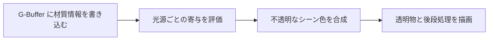

import TopicSummary from "../../../components/TopicSummary.astro";
import PageEnd from "../../../components/PageEnd.astro";

<TopicSummary />

## 概要

ジオメトリの描画と照明計算を分け、平行・点・スポット・面光源を同じ材質情報から評価する構成です。

## 処理フロー図



## 設計判断・処理の流れ

ジオメトリと照明の処理を分け、複数種類の光源で同じG-Bufferを参照します。半透明の描画は別のパスで扱います。

## 実装のポイント

deferred_lighting_ps.hlslはG-Bufferの法線、粗さ、アルベド、金属度、位置、AO、エミッシブを取得します。各種光源の寄与とIBLを集め、材質AOとSSAOを拡散・鏡面成分へ適用します。SSAOはt7から参照します。半透明モデルはScene_IndoorのForwardパスで描画します。

### 現行コードの抜粋

```hlsl
    float ssao = ssao_texture.SampleLevel(sampler_states[POINT_CLAMP], pin.texcoord, 0).r;
    diffuse *= occlusion * ssao;
    specular *= occlusion * ssao;

```

## 制約・検証

フルスクリーン1パスでも光源ループのコストは光源数とともに増えます。タイルド・クラスタード照明とは異なる構成です。画面空間の反射・間接光・時間フィルタは、この照明パスの後で扱います。

## ソースコード

[deferred_lighting_ps.hlsl — 実装を読む](https://github.com/rumo-dev/AtmosFiore/blob/master/Project/source/Engine/Graphics/Shader/deferred_lighting_ps.hlsl)

公開版と開発中のローカル版では、更新時点が異なる場合があります。

<PageEnd />
