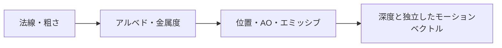

import TopicSummary from "../../../components/TopicSummary.astro";
import PageEnd from "../../../components/PageEnd.astro";

<TopicSummary />

## 概要

ディファード照明と画面空間エフェクトで共通利用する情報を、複数のレンダーターゲットへ書き出します。

## G-Bufferのデータ構成図



## 設計判断・処理の流れ

材質を保持する4枚のRTと、深度・モーションベクトルを分けます。照明パスのレジスタ配置を保ちながら、時間方向の処理を追加する構成です。

```text
ジオメトリ描画 → 材質4RT + Motion RT + Depth → ライティング・画面空間処理
```

## 実装のポイント

材質用4枚はNormal/Roughness（RGBA16F）、Albedo/Metalness（RGBA8）、Position/AO（RGBA32F）、Emissive/Specular（RGBA16F）です。位置は深度から復元せず、ワールド座標を直接保持します。FP16では約32m付近で座標の丸め幅がセンチメートル単位になるため、影の深度比較や受光面勾配に使う位置にはFP32を選んでいます。深度はR32_TYPELESSをDSVではD32_FLOAT、SRVではR32_FLOATとして参照し、速度はR16G16_FLOATの独立RTに書き出します。

### 現行コードの抜粋

```cpp
  DXGI_FORMAT formats[GBUFFER_COUNT] =
  {
    DXGI_FORMAT_R16G16B16A16_FLOAT,
    DXGI_FORMAT_R8G8B8A8_UNORM,
    DXGI_FORMAT_R32G32B32A32_FLOAT,
    DXGI_FORMAT_R16G16B16A16_FLOAT,
  };

```

## 制約・検証

材質4RTは36 bytes/pixelです。1920×1080では約71.2 MiB、深度とモーションベクトルを加えると約87.0 MiBになります。これは各ピクセルのフォーマット容量を足した理論値で、パディング・ドライバ管理・他の中間バッファを含む実測VRAMではありません。

## ソースコード

[geometry_buffer.cpp — 実装を読む](https://github.com/rumo-dev/AtmosFiore/blob/master/Project/source/Engine/Graphics/geometry_buffer/geometry_buffer.cpp)

公開版と開発中のローカル版では、更新時点が異なる場合があります。

<PageEnd />
