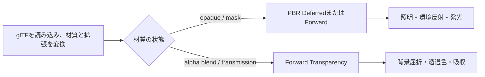

import TopicSummary from "../../../components/TopicSummary.astro";
import FeatureMedia from "../../../components/FeatureMedia.astro";
import PageEnd from "../../../components/PageEnd.astro";

<TopicSummary />

## 概要

AtmosFioreのglTF材質処理は、基本のMetallic-Roughnessに加えて複数の`KHR_materials_*`拡張を読み込みます。CPU側で材質値とテクスチャ情報をStructuredBuffer用データへ変換し、Forward PBRシェーダーで評価します。

## 効果比較

<FeatureMedia title="glTF clearcoat材質" beforeImage="/media/atmosfiore/captures/screenshots/gltf_pbr_clearcoat_off.png" afterImage="/media/atmosfiore/captures/screenshots/gltf_pbr_clearcoat_on.png" beforeLabel="Clearcoat OFF" afterLabel="Clearcoat ON" caption="同じテストモデルでclearcoat項目だけを切り替えたキャプチャです。" />

## 対応する材質情報

| glTF情報 | 描画で使う内容 |
| --- | --- |
| Metallic-Roughness | base color、metallic、roughness、各テクスチャ |
| 標準の追加情報 | normal、occlusion、emissive、alphaMode、doubleSided |
| `KHR_materials_clearcoat` / `ior` | クリアコート層と誘電体の屈折率 |
| `KHR_materials_specular` / `sheen` | 鏡面反射強度・色、布地向けのsheen |
| `KHR_materials_iridescence` / `anisotropy` | 薄膜干渉色と方向性反射 |
| `KHR_materials_transmission` / `volume` / `dispersion` | 透過、厚み・吸収、簡易的な色分散 |
| `KHR_materials_emissive_strength` / `unlit` | emissive倍率と照明を受けない材質 |

テクスチャごとのUVセット選択と`KHR_texture_transform`も材質データへ反映します。材質構造は17個のテクスチャ参照を含み、CPUとHLSLで共有するレイアウトとして定義されています。

## 描画パス

OPAQUEとMASKはDeferred PBRの対象にできます。BLENDまたは透過率を持つ材質はForward Transparencyへ送り、Deferredジオメトリやシャドウパスから除外します。二面材質では裏面法線を反転し、透過体の裏面は厚み計算と整合させるため除外します。

## 実装上の判断

材質パーサーは拡張のfactorとtexture参照を既定値付きで読み取り、GPUへ渡します。シェーダーは有効な値に応じてGGX反射、clearcoat、sheen、iridescence、anisotropyを評価します。透過では画面上の背景を屈折方向からサンプルし、厚みとattenuation colorで吸収を近似します。dispersionはRGBごとに屈折率をずらして色分離を表現します。

## 制約

透過はレイトレーシングによる屈折ではなく、画面バッファを使った近似です。画面外の背景や画面に描かれていない物体は屈折像に現れません。透明・透過材質はForward経路へ分かれるため、Deferred専用機能や影パスと同じ条件では扱いません。対応拡張の有無と、glTF仕様全体への完全準拠は区別しています。

## ソースコード

- [gltf_pbr_material.h — 材質データと拡張の読み込み](https://github.com/rumo-dev/AtmosFiore/blob/master/Project/source/Engine/Graphics/Model/gltf_pbr_material.h)
- [gltf_model.cpp — 材質と描画パスの振り分け](https://github.com/rumo-dev/AtmosFiore/blob/master/Project/source/Engine/Graphics/Model/gltf_model.cpp)
- [gltf_pbr_forward.hlsli — Forward PBR評価](https://github.com/rumo-dev/AtmosFiore/blob/master/Project/source/Engine/Graphics/Shader/gltf_pbr_forward.hlsli)

<PageEnd />
