import TopicIndex from "../../../components/TopicIndex.astro";
import PageEnd from "../../../components/PageEnd.astro";

AtmosFioreは、室内空間特有の「光の差し込み」「空気感」をDirectX 11上でフォトリアルに描き出すカスタムレンダリングパイプラインです。
このセクションでは、本シェーダーエンジンを構成する主要な技術について詳細なアルゴリズムとコード（HLSL/C++）の解説を提供します。

## レンダリングパイプライン

AtmosFioreは、複雑なマテリアルと高精度な反射を両立させるため、以下のパイプラインに沿って描画処理を行っています。

```mermaid
graph TD
    A[1. ジオメトリパス G-Buffer生成] --> B[2. ライティングパス]
    B --> C[3. IBL / シャドウマッピング]
    C --> D[4. ポストプロセス Bloom / Tone Mapping / Adaptation]
    D --> E[最終画面出力]
    style B fill:#451a03,stroke:#f59e0b,stroke-width:2px
    style C fill:#1e3a8a,stroke:#3b82f6,stroke-width:2px
    style D fill:#064e3b,stroke:#10b981,stroke-width:2px
```

## まず読むなら（採用ご担当者さま向け）

実装の深さや設計判断が伝わりやすい5本です。各ページの冒頭に「30秒で分かる要点」を付けています。

<TopicIndex featuredOnly />

## すべての技術解説

全21本を、役割ごとに分類しています。

<TopicIndex />

## 各ページの読み方

- **冒頭の要点カード:** 何を作ったか・見どころ・読了目安を30秒で確認できます。
- **比較デモ:** 機能の ON/OFF をスライダーで見比べられます（画像は順次追加中）。
- **設計判断:** なぜその手法を選んだかを、検討した他の選択肢とあわせて記載しています。
- **実装のポイント:** コードを読み飛ばしても、工夫した点だけ把握できる章です。

<PageEnd />
