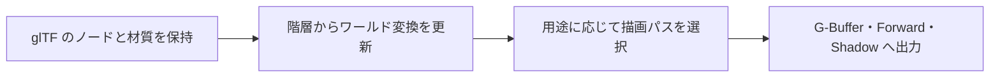

import TopicSummary from "../../../components/TopicSummary.astro";
import PageEnd from "../../../components/PageEnd.astro";

<TopicSummary />

## 概要

複数の描画機能を同じシーンで評価するため、モデル読込から材質とアニメーション、描画パスへの振り分けを実装しました。

## 処理フロー図



## 設計判断・処理の流れ

モデルのノード、材質、アニメーションの情報を保持し、描画パスに応じて出力先を切り替えます。

## 実装のポイント

Gltf_Modelはノードの親子構造、スキン参照、ローカル変換とワールド変換を保持します。pass_modeでDeferred Geometry、Forward Opaque、Forward Transparency、Directional Shadow、Shadowを区別します。Model_Managerではアニメーション更新の仕事をまとめてJobSystemへ渡します。

### 現行コードの抜粋

```cpp
enum class pass_mode
{
  deferred_geometry,      ///< GBuffer書き込み
  forward_opaque,         ///< 不透明フォワード描画
  forward_transparency,   ///< 透明描画
  directional_shadow,     ///< 平行光源シャドウマップ生成
  shadow                  ///< シャドウマップ生成
};

```

## 制約・検証

glTFのすべての拡張への対応を示すものではありません。不透明・透明の境界、スキニング、前フレームの変換を含む速度出力は、それぞれのシーンで確認が必要です。

## ソースコード

[gltf_model.h — 実装を読む](https://github.com/rumo-dev/AtmosFiore/blob/master/Project/source/Engine/Graphics/Model/gltf_model.h)

公開版と開発中のローカル版では、更新時点が異なる場合があります。

<PageEnd />
