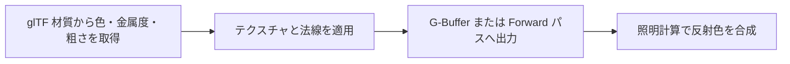

import { Aside } from "@astrojs/starlight/components";

import TopicSummary from "../../../components/TopicSummary.astro";
import PageEnd from "../../../components/PageEnd.astro";

<TopicSummary />

## 概要

AtmosFioreはglTF 2.0の`pbrMetallicRoughness`を基本ワークフローとして使います。Base Color・Metallic・Roughnessなどの標準材質はDeferredまたはForwardで処理します。実装ではclearcoat、transmission、iridescenceなどの`KHR_materials_*`拡張も扱いますが、拡張材質をすべてG-Bufferへ格納するわけではありません。対応拡張と描画パスの詳細は[glTF PBR材質の記事](./gltf-pbr/)を参照してください。

## 処理フロー図




## 設計判断・処理の流れ

材質を金属度と粗さなどの共通パラメータで表し、照明の種類が変わっても同じ材質情報を使います。

## 実装のポイント

### 基本的な考え方

物理ベースレンダリングは、光の反射をエネルギー保存則に基づいて計算する手法です。AtmosFioreでは、金属か非金属かを1つのMetallicパラメータで滑らかに補間する **Metallic-Roughnessワークフロー** を採用し、アーティストが直感的にパラメータ調整できるようにしています。

#### マテリアルパラメータ構造（glTF準拠）

```cpp
// https://www.khronos.org/registry/glTF/specs/2.0/glTF-2.0.html#reference-material-pbrmetallicroughness
struct pbr_metallic_roughness
{
    float4       basecolor_factor;          // len = 4. default [1,1,1,1]
    texture_info basecolor_texture;
    float        metallic_factor;           // default 1
    float        roughness_factor;          // default 1
    texture_info metallic_roughness_texture;
};

struct material_constants
{
    float3 emissive_factor;                 // length 3. default [0, 0, 0]
    int    alpha_mode;                      // "OPAQUE" : 0, "MASK" : 1, "BLEND" : 2
    float  alpha_cutoff;                    // default 0.5
    int    double_sided;                    // default false

    pbr_metallic_roughness pbr_metallic_roughness;

    normal_texture_info    normal_texture;
    occlusion_texture_info occlusion_texture;
    texture_info           emissive_texture;
};
StructuredBuffer<material_constants> materials : register(t0);
```

#### パラメータの物理的意味

| パラメータ | 意味                                     | 表現できるもの                          |
| ---------- | ---------------------------------------- | --------------------------------------- |
| Base Color | 誘電体では拡散反射色、金属では鏡面反射色 | 大理石の地色、木目のベースカラー        |
| Metallic   | 0=誘電体（非金属）、1=金属               | 金属製の建具・取っ手 vs 布・木材        |
| Roughness  | 微小面（マイクロファセット）の粗さ       | 磨かれた大理石（低）〜 マットな布（高） |
| Normal     | 法線マップによる微細凹凸                 | 木材の木目、布のシワ                    |
| Occlusion  | 環境光の遮蔽度                           | 隙間・溝の陰影                          |
| Emissive   | 自己発光色                               | ランプの発光部分                        |

### HLSL の実装：BRDFの物理パラメータへの変換

Metallic-Roughnessワークフローの核心は、Base ColorとMetallicから鏡面反射率（F0）と拡散反射色を導出する部分です。

```hlsl
// deferred_lighting_ps.hlsl（ライティングパス：G-Bufferから読み出し）
float3 basecolor = sampled.xyz;
float  metallic  = sampled.w;

// 非金属のF0は誘電体の代表値4%（0.04）で固定し、金属はBase ColorをそのままF0として扱う
const float3 f0    = lerp(0.04f, basecolor, metallic);
const float3 f90   = 1.0f;
const float  alpha_roughness = roughness * roughness; // Disney remapping（知覚的ラフネス→実効ラフネス）

// 金属は拡散反射を持たない（全反射が鏡面成分に回るため）
const float3 c_diff = lerp(basecolor, 0.0f, metallic);
```

```hlsl
// bidirectional_reflectance_distribution_function.hlsli
// Cook-Torrance鏡面BRDF: D（法線分布）・G/Vis（幾何減衰）・F（フレネル）の積
float3 brdf_specular_ggx(float3 f0, float3 f90, float alpha_roughness, float VoH, float NoL, float NoV, float NoH)
{
    float3 F   = f_schlick(f0, f90, VoH);
    float  Vis = v_ggx(NoL, NoV, alpha_roughness);
    float  D   = d_ggx(NoH, alpha_roughness);

    return F * Vis * D;
}

// Lambert拡散BRDF: フレネル反射に回らなかったエネルギーのみを拡散させる（エネルギー保存）
float3 brdf_lambertian(float3 f0, float3 f90, float3 diffuse_color, float VoH)
{
    const float PI = 3.14159265358979;
    return (1.0 - f_schlick(f0, f90, VoH)) * (diffuse_color / PI);
}
```

### 処理の詳細

#### Metallic-Roughnessによる単一ワークフロー

Specular-Glossinessなど他のワークフローと異なり、マテリアルの型（金属/非金属）と粗さを2枚のテクスチャ（Base Color + ORM）だけで表現できるため、テクスチャ容量とシェーダー分岐の両方を削減できます。

#### Roughnessのリマッピング

知覚的に線形なRoughnessパラメータ（アーティストが調整する値）をそのままGGX分布関数に渡すとハイライトが不自然に鋭くなるため、`alpha_roughness = roughness * roughness` で実効ラフネスに変換してから使用します。

#### G-Bufferへの受け渡し

Deferred対象の基本材質情報は[ G-Buffer](./gbuffer/)へ格納し、[Deferred Lighting](./deferred-lighting/)と[IBL](./ibl/)で参照します。透過や拡張材質の追加パラメータはForward PBR側で評価するものがあります。

<Aside type="note">
  BRDFの具体的な数式（Fresnel-Schlick近似・Smith Joint
  GGX）と[IBL](./ibl/)との組み合わせについては、Deferred
  LightingおよびIBLの記事で解説しています。
</Aside>

## 制約・検証

<Aside type="caution">
  glTF仕様に存在する全拡張が実装済みという意味ではありません。また、screen-space transmissionは画面に存在しない背景を屈折できません。対応範囲と近似の限界は[glTF PBR材質の記事](./gltf-pbr/)にまとめています。
</Aside>

## ソースコード

- [bidirectional_reflectance_distribution_function.hlsli — 実装を読む](https://github.com/rumo-dev/AtmosFiore/blob/master/Project/source/Engine/Graphics/Shader/bidirectional_reflectance_distribution_function.hlsli)

公開版と開発中のローカル版では、更新時点が異なる場合があります。

<PageEnd />
