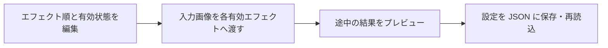

import TopicSummary from "../../../components/TopicSummary.astro";
import PageEnd from "../../../components/PageEnd.astro";

<TopicSummary />

## 概要

個々のエフェクトを組み合わせて比較・調整できるよう、処理順と設定を管理するクラスを設計しました。

## 処理フロー図



## 設計判断・処理の流れ

エフェクト単体の実装と、順序・有効状態・設定の管理を分けます。画作りを比較しながら調整できる構成です。

```text
SSAO → Deferred/Forward → SSR → SSGI → TAA（DLSS有効時は省略）→ エフェクト群とDLSS処理 → 最終出力
```

## 実装のポイント

effect_orderはSky、4種類のFog、DoF、Exposure、色収差、歪曲、Vignetting、Bloom、Adaptation、ToneMappingの13項目を持ちます。effect_enabledと組み合わせてGUIで編集し、JSONの保存・読込に対応します。SSR・SSGI・TAAはこの13項目とは別の処理です。

操作UIはエフェクトの有効状態とパラメータ編集を分けています。プレゼンテーションモードでは、有効なエフェクトだけ設定タブに表示するため、説明中に不要な設定が並びません。Scene側の比較スイッチとポストプロセス設定も別タブに整理しています。

### 現行コードの抜粋

```cpp
std::array<Post_Process_Manager::EffectId, 13> Post_Process_Manager::effect_order = {
  EffectId::Sky, EffectId::VolumetricFog, EffectId::HeightFog, EffectId::DistanceFog,
  EffectId::ExponentialFog, EffectId::DoF, EffectId::Exposure, EffectId::ChromaticAberration,
  EffectId::LensDistortion, EffectId::Vignetting, EffectId::Bloom,
  EffectId::Adaptation, EffectId::ToneMapping
};
std::array<bool, 13> Post_Process_Manager::effect_enabled{};
```

## 制約・検証

順序を変えれば見え方も変わります。HDR処理と表示変換の関係を保ちながら調整する必要があります。解像度変更では中間バッファを再生成し、履歴をリセットします。SSR検証用モードでは他エフェクトを一時無効化する経路もあります。

## ソースコード

[post_process_manager.cpp — 実装を読む](https://github.com/rumo-dev/AtmosFiore/blob/master/Project/source/Engine/System/Manager/PostProcess/post_process_manager.cpp)

公開版と開発中のローカル版では、更新時点が異なる場合があります。

<PageEnd />
