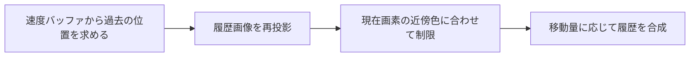

import TopicSummary from "../../../components/TopicSummary.astro";
import PageEnd from "../../../components/PageEnd.astro";

<TopicSummary />

## 概要

フレーム間の情報を再利用する時間方向のフィルタを実装しました。現在の実装範囲は、履歴の再投影と安定化です。

## 処理フロー図



## 設計判断・処理の流れ

モーションベクトルで過去の色を再投影し、現在の近傍色に収まるようクランプして履歴を合成します。

```text
現在色・履歴・モーションベクトル → 過去UVの算出 → 5点近傍クランプ → 履歴との混合
```

## 実装のポイント

現在画素と上下左右の5点で色の最小・最大を求め、履歴色をその範囲へ制限します。移動量が大きい画素ほど履歴の重みを下げます。画面外への再投影や履歴が無効な場合は現在色を返し、設定変更・解像度変更時に履歴をリセットします。

### 現行コードの抜粋

```hlsl
    float3 history = history_color.SampleLevel(
        sampler_states[LINEAR_CLAMP], previous_uv, 0).rgb;
    history = clamp(history, neighborhood_min, neighborhood_max);
    const float motion_pixels = length(velocity / float2(inverse_width, inverse_height));
    const float weight = history_weight * (1.0f - saturate(motion_pixels / 32.0f));
    return float4(lerp(current.rgb, history, weight), current.a);
}
```

## 制約・検証

モーションベクトルで投影オフセットを十分相殺できていないため、GetTAAJitterNdcはゼロを返します。ジッターによるサブピクセル情報の蓄積を備えた完成形のTAAとは区別して評価しています。DLSS有効時はこのTAAパスを実行しません。

## ソースコード

[taa_ps.hlsl — 実装を読む](https://github.com/rumo-dev/AtmosFiore/blob/master/Project/source/Engine/Graphics/Shader/taa_ps.hlsl)

公開版と開発中のローカル版では、更新時点が異なる場合があります。

<PageEnd />
